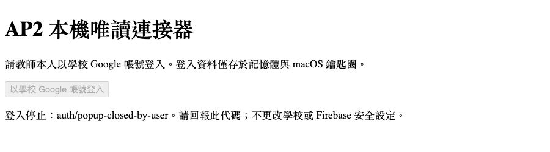

# 本機 MCP 第 1–2 階段報告（2026-10-15）

## 現況
- 分支 feature/platform-mcp；獨立 worktree：`/Users/HHC/Documents/ChatGPT/課程平台1.0/.worktrees/platform-mcp`。
- 基底為最新 origin/main@4ed3778e67a630dfe9cc8ea13096cc220a616868；原根目錄呼吸工作與其他 worktree 不修改。
- 第1階段完成：盤點 functions/src/ 五份檔案、57個 callable；見 CALLABLE_INVENTORY.md。
- 第2階段本機程式、離線驗證、教師登入及可支援工具的正式 AP2 唯讀 smoke 已完成；**仍有3個工具缺純唯讀後端，不能宣稱7個工具完整可用**，交 Claude 驗收與裁定缺口。
- 教師本人完成學校 Google 登入，程式確認教師簽章與claim、refresh身分相同，refresh token已存鑰匙圈；實際 callable 與stdio成功。本次未遇學校帳號或App Check拒絕，不更動其安全設定。

## 工具清單
| 工具 | 狀態／資料邊界 |
|---|---|
| list_courses | 固定 available:false。bootstrap會寫profile；本輪不拿它當唯讀入口 |
| get_course_draft | 固定 available:false。沒有教師純唯讀草稿入口 |
| get_published | getPublished；僅課程內容投影，不含名冊／teacherIds／Sheets網址 |
| diff_draft_published | 固定 available:false；不能取得真實草稿，不以本機假資料替代。diff純函式已測 |
| get_sync_status | getSyncStatus；專案級時間／結果／錯誤旗標／歷史staleUnits；不回錯誤全文與名冊明細 |
| list_materials | shared/materials.ts AP2目錄38份；指定課程「已發布」活動使用位置，草稿使用未知 |
| get_completion_summary | getCompletion；分頁在記憶體用平台forClass＋completion公式3彙總，只輸出數字 |

三個受限工具是**未具備可用後端的功能**，不是完整實作通過；其 unavailable 結果可驗證，不能計為真實課程讀取成功。本輪依「不改functions、不寫入」限制保留此缺口，交 Claude／教師判定後續另案。

## 安全實作
- 官方 MCP TypeScript SDK 1.x、stdio；套件、lock、依賴只在 tools/platform-mcp/。
- HTTPS endpoint固定 ap2-7ed91／asia-east1。硬白名單僅 getPublished／getSyncStatus／getCompletion，驗證在 token讀取與網路之前。沒有 generic callable／REST／Admin SDK／寫入工具。
- bootstrap、getReflections（初始化salt）、getAssessments／assessmentReport（逾時結算）及其他寫入入口全部拒絕。
- 登入由教師本人操作 localhost Google popup，與正式AP2相同公開Firebase設定；inMemoryPersistence。簽章／issuer／audience／expiry／teacher claim驗證，學校Google provider驗證，refresh同一身分驗證。
- refresh token只存macOS鑰匙圈 platform-mcp-ap2；security -i stdin存入，token不在argv、檔案、設定或log；啟動／每次callable前重取ID token並驗teacher。鑰匙圈寫後讀回核對但不輸出秘密。
- 輸出先按工具投影／彙總，再做遞迴個資欄位移除、email／學號／JWT掃描；錯誤全文不透出，保護無法正則可靠辨識的人名。這不是通用人名匿名化器。
- App Check／401認證阻擋會鎖住該client後續呼叫；不放寬任何安全設定。
- 完成度分頁屬即時讀取而非一致快照；超限／循環／失敗不回半份總數。

## 驗證證據
- `unit-check.txt`：型別檢查、14測試全過、0失敗／0 skipped，CLI及登入client建置通過。
- 白名單（含欺騙性get入口）、巢狀個資／動態學號key、teacher缺失／false／字串拒絕、diff、三工具無網路降級、published投影、38份教材使用、跨頁完成度／班級門檻覆寫／必做活動、游標循環、同步錯誤遮罩、固定endpoint、App Check鎖定、輸入限制、官方SDK協定均已驗證。
- `npx --no-install platform-mcp --version` 回 platform-mcp 0.1.0，確認本機bin可解析；執行在正常npm快取權限環境，未全域安裝。
- `git diff --exit-code origin/main -- functions src shared package.json package-lock.json functions/package.json functions/package-lock.json firestore.rules firebase.json .github/workflows` 零差異。
- 正式 smoke：`live-smoke.txt` 與 `readonly-smoke/` 共8份JSON（7工具＋stdio handshake）；4工具成功、3工具如實 unavailable，所有輸出存檔前個資掃描0。完成度只讀test班：2列／2啟用，0完成學生，必做單元機會數12；未碰正式班輪次或作答。
- 官方SDK實際stdio client列出7個readOnly工具，再成功呼叫get_published，證據 `readonly-smoke/stdio-handshake.json`。這是實際鑰匙圈刷新與HTTPS讀取，非fixture。
- 首次Google彈窗關閉後本機收到 `auth/popup-closed-by-user`，不誤報為學校阻擋；教師重新操作後，本機程式明確回報「教師登入成功；鑰匙圈已保存」，使用者也確認成功。成功頁已由使用者關閉，未補造成功截圖；改由成功登入紀錄與實際stdio／smoke證明。首次安全錯誤畫面如下，不含帳號／token：

## 第3階段建議（未實作）
- 優先另案補 listManagedCourses／getCourseDraft 純唯讀 callable，才能提供真實課程列表、草稿和diff；加後端完成度aggregate可避免名冊離開後端。
- patchCourseDraft：交易內owner授權、欄位白名單、expectedRevision、所有草稿寫入路徑一致遞增revision；現有updatedAt不能可靠防覆蓋。
- auditLog：同交易保存requestId、actor、操作、時間、revision與清理過的差異；嚴禁token／學生作答，另規畫預覽確認。
- 只記錄設計，不修改或部署Functions。本輪不push／部署／同步／操作學生資料，Claude桌面設定由教師驗收後自行加入。

## 接手方式
先讀工具 README、CALLABLE_INVENTORY、unit-check與live-smoke證據；獨立重跑 tools/platform-mcp 的 npm ci／npm run check，再由教師決定是否執行唯讀 smoke。三個 unavailable 項目須在驗收中明列，不能當作完整功能通過。本機 commit 後停止，不 push／部署，也不替教師修改 Claude 桌面設定。

官方依據：[MCP SDK](https://ts.sdk.modelcontextprotocol.io/server)、[Firebase callable協定](https://firebase.google.com/docs/functions/callable-reference)、[App Check enforcement](https://firebase.google.com/docs/app-check/cloud-functions)、[Auth REST refresh](https://firebase.google.com/docs/reference/rest/auth#section-refresh-token)。
